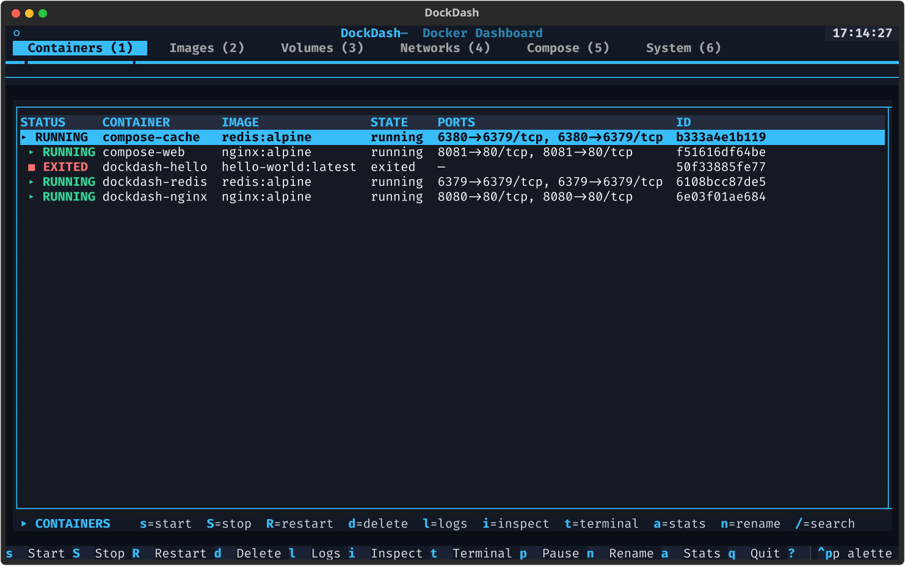
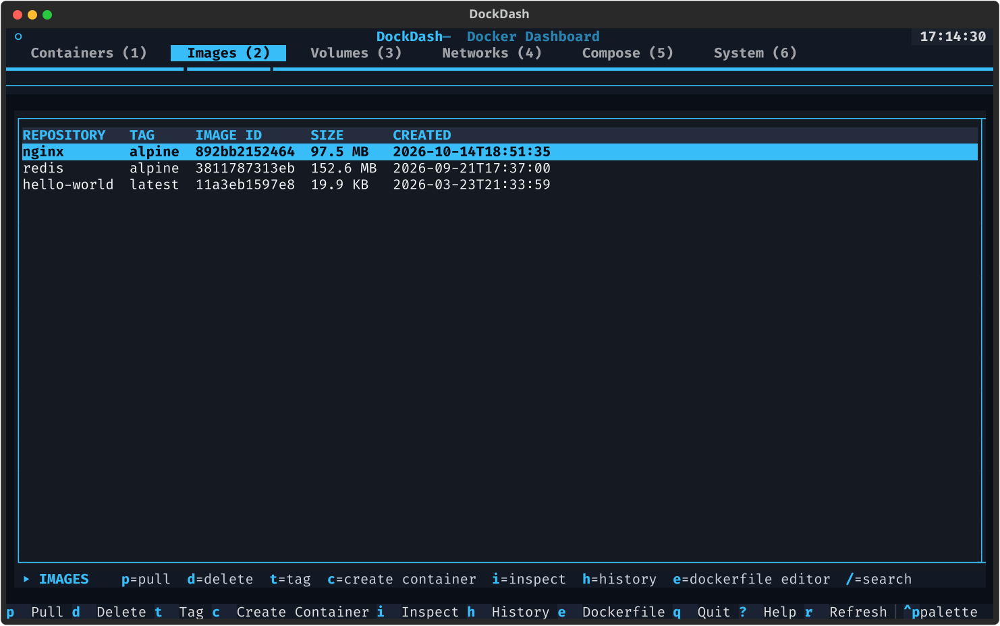
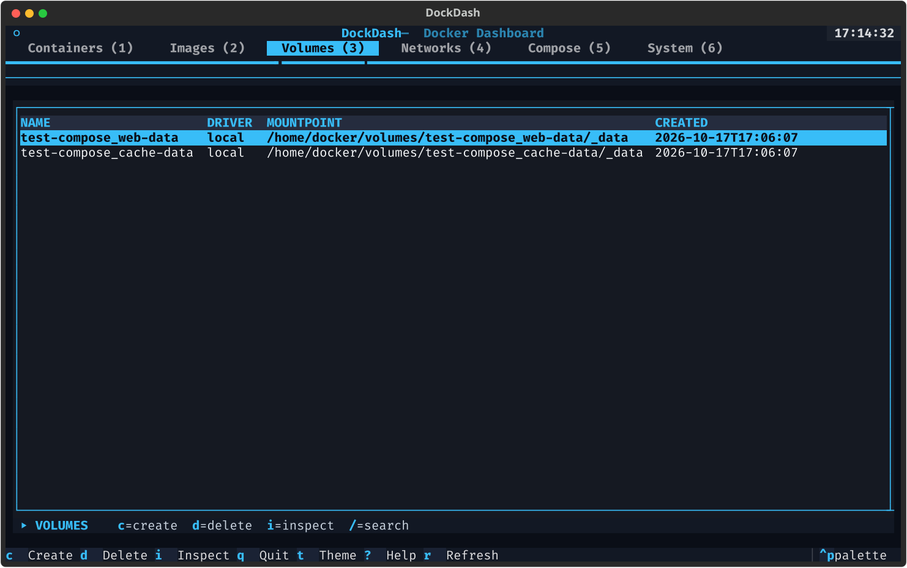
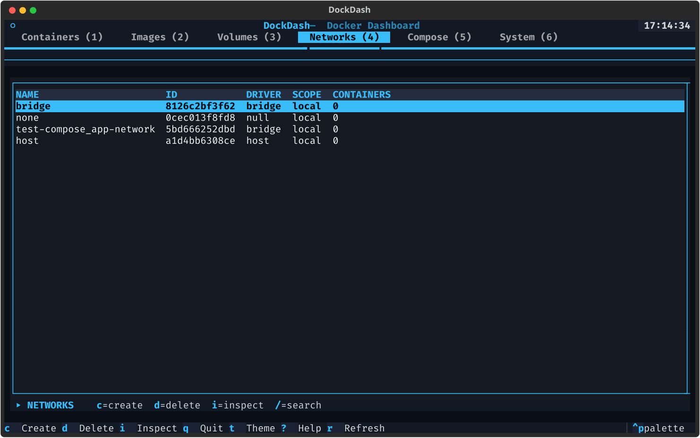
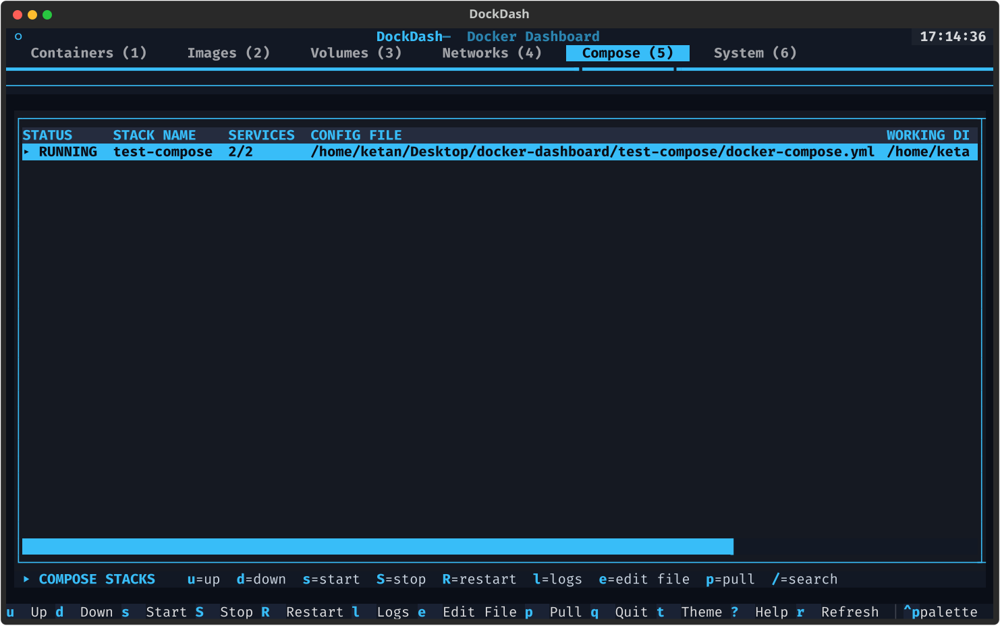
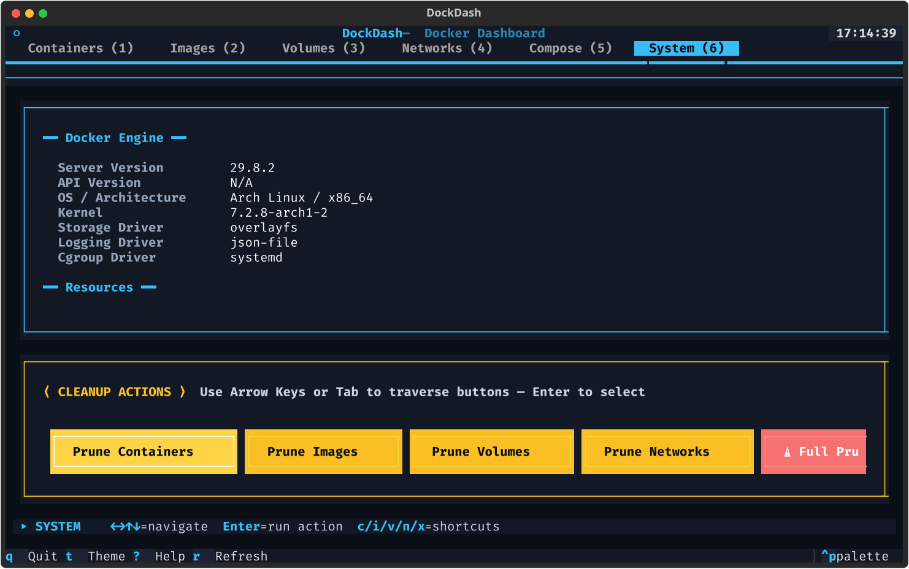
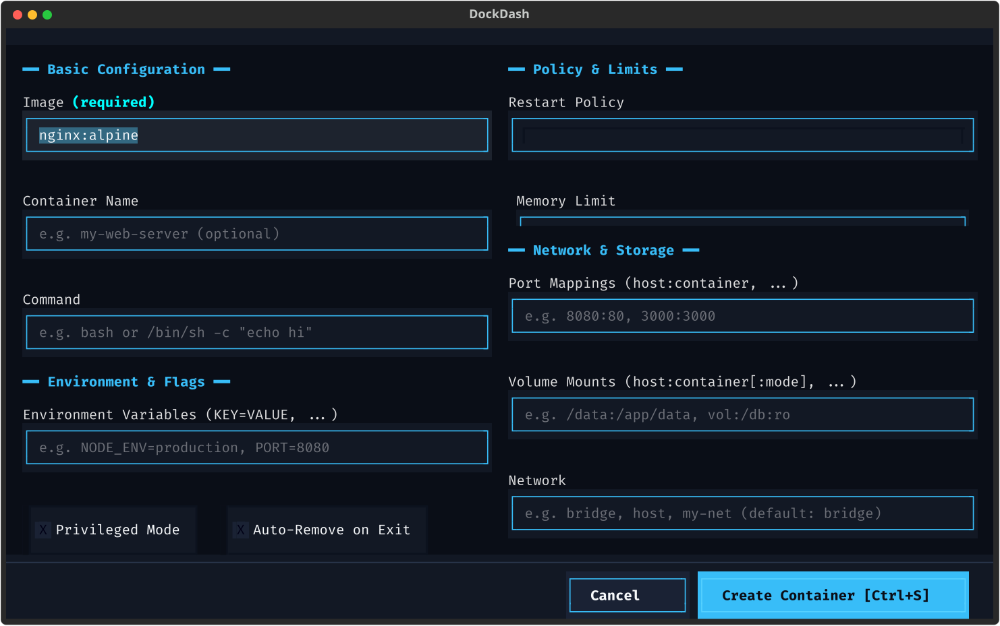
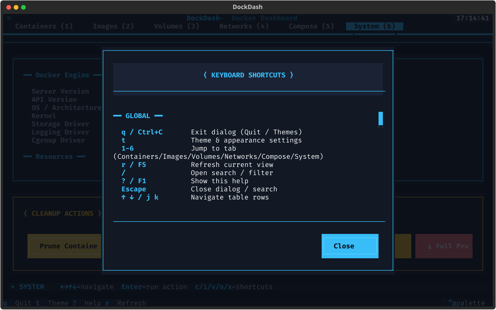

<h1 align="center">DockDash</h1>

<p align="center">
  <strong>A powerful, keyboard-driven Docker management dashboard for the terminal.</strong>
</p>

<p align="center">
  <a href="https://github.com/Ketan-Chaudhary/dockerdash/releases"></a>
  <a href="https://github.com/Ketan-Chaudhary/dockerdash/actions/workflows/ci.yml"></a>
  <a href="https://github.com/Ketan-Chaudhary/dockerdash/blob/main/LICENSE"></a>
  <a href="https://github.com/Ketan-Chaudhary/dockerdash/stargazers"></a>
  <a href="https://github.com/Ketan-Chaudhary/dockerdash/issues"></a>
</p>

<p align="center">
  <a href="#features">Features</a> •
  <a href="#screenshots">Screenshots</a> •
  <a href="#quick-start">Quick Start</a> •
  <a href="#keyboard-shortcuts">Shortcuts</a> •
  <a href="#architecture">Architecture</a> •
  <a href="#contributing">Contributing</a> •
  <a href="#license">License</a>
</p>

---

## Why DockDash?

Managing Docker through `docker ps`, `docker logs`, and `docker inspect` gets tedious fast. DockDash brings the power of desktop Docker tools into your terminal — with zero browser dependencies, instant keyboard navigation, and a high-contrast UI built on [Textual](https://textual.textualize.io/).

```bash
git clone https://github.com/Ketan-Chaudhary/dockerdash.git
cd dockerdash && pip install -e . && dockdash
```

---

## Features

### Container Management
- **Full lifecycle control** — Start, stop, restart, pause/unpause, rename, and force-remove containers
- **Real-time stats** — Live CPU%, memory, network I/O, disk I/O, and PID count bars
- **Streaming log viewer** — Real-time `tail -f` with live search (`/`), match highlighting, auto-scroll (`a`), timestamps (`t`), line wrap (`w`), and export to file (`s`)
- **Interactive shell** — Attach directly to running containers via `docker exec -it`

### Image Management
- **Pull, delete, tag/rename, and inspect** images with full JSON detail
- **Layer history viewer** — Explore image build layers and sizes
- **Dockerfile editor** — Built-in full-screen editor with line numbers and direct `docker build`
- **Container creation wizard** — Responsive 2-column form for ports (host:container and ip:host:container), volumes, environment variables, restart policies, and resource limits

### Volumes & Networks
- **Create, inspect, and remove** Docker volumes and networks
- **Built-in protection** against accidental deletion of system networks (`bridge`, `host`, `none`)

### Docker Compose Stacks
- **Auto-discovery** — Stacks grouped automatically by project labels or local `docker-compose.yml` files
- **Full lifecycle** — `up`, `down`, `start`, `stop`, `restart`, `pull`
- **Combined log streaming** — View aggregated logs for entire stacks
- **Compose file editor** — Edit `docker-compose.yml` files directly in the TUI

### System & Cleanup
- **Engine overview** — Real-time Docker Engine attributes, version info, and disk usage breakdown
- **Granular pruning** — Prune stopped containers, dangling images, unused volumes, unused networks, or trigger a full system prune

### General
- **Keyboard-first** — Every action is one or two keystrokes away
- **Live search & filtering** — Press `/` on any tab to instantly filter results
- **Curated color templates & themes** — Choose from 9 palettes (Cyber Slate, Tokyo Night, Dracula, Nord, Catppuccin, Monokai, Gruvbox, Synthwave, Solarized) with real-time live preview and persistent settings
- **Cross-platform** — Linux, macOS, and Windows (standalone binaries available)

---

## Screenshots

<details>
<summary><strong>Containers Tab</strong> — Full lifecycle control with live stats and log streaming</summary>
<br>

</details>

<details>
<summary><strong>Images Tab</strong> — Pull, inspect, build, and launch containers from images</summary>
<br>

</details>

<details>
<summary><strong>Volumes Tab</strong> — Manage persistent storage volumes</summary>
<br>

</details>

<details>
<summary><strong>Networks Tab</strong> — Docker network management with system protection</summary>
<br>

</details>

<details>
<summary><strong>Compose Stacks</strong> — Multi-container project management</summary>
<br>

</details>

<details>
<summary><strong>System Overview</strong> — Engine info, disk usage, and prune tools</summary>
<br>

</details>

<details>
<summary><strong>Container Creation Wizard</strong> — Full-screen responsive form</summary>
<br>

</details>

<details>
<summary><strong>Keyboard Shortcuts Modal</strong> — Press <code>?</code> for the full reference</summary>
<br>

</details>

---

## Quick Start

### Prerequisites

| Requirement | Minimum Version |
| :--- | :--- |
| Python | `>= 3.10` |
| Docker Engine | Running locally or via Docker Desktop |
| OS | Linux, macOS, or Windows |

### Install from Source

```bash
# Clone the repository
git clone https://github.com/Ketan-Chaudhary/dockerdash.git
cd dockerdash

# Create and activate a virtual environment
python -m venv .venv
source .venv/bin/activate    # Windows: .venv\Scripts\activate

# Install in editable mode
pip install -e .

# Launch
dockdash
```

### Standalone Binaries

Pre-built executables requiring **no Python installation** are available on the [Releases](https://github.com/Ketan-Chaudhary/dockerdash/releases) page:

| Platform | Instructions |
| :--- | :--- |
| **Linux (x86_64)** | `tar -xzvf dockdash-linux-x86_64-<version>.tar.gz && ./dockdash` |
| **Windows** | Download `dockdash.exe` → run from PowerShell: `.\\dockdash.exe` |
| **Arch Linux** | Build via included `PKGBUILD`: `makepkg -si` |

---

## Keyboard Shortcuts

DockDash is fully operable via keyboard. Press `?` or `F1` at any time for the complete reference.

### Global

| Key | Action |
| :---: | :--- |
| `1` – `6` | Switch tabs (Containers / Images / Volumes / Networks / Compose / System) |
| `t` / `T` | Open color templates & theme settings |
| `r` / `F5` | Refresh current tab |
| `/` | Open search & filter bar |
| `?` / `F1` | Open keyboard shortcuts help |
| `q` / `Ctrl+C` | Exit dialog (Quit / Themes / Cancel) |
| `Esc` | Close active dialog, filter, or modal |

### Containers (`1`)

| Key | Action |
| :---: | :--- |
| `s` | Start |
| `S` | Stop |
| `R` | Restart |
| `p` | Pause / Unpause |
| `n` | Rename |
| `d` | Delete (with confirmation) |
| `l` | Open log viewer |
| `a` | Toggle live stats panel |
| `i` | JSON inspect |
| `t` | Attach terminal (Quick shell picker: auto / bash / sh / zsh / ash) |
| `Enter` | Toggle detail side panel |

### Log Viewer (`l`)

| Key | Action |
| :---: | :--- |
| `f` | Toggle live follow (`tail -f`) |
| `a` | Toggle auto-scroll |
| `/` | Live search & regex filter |
| `t` | Toggle timestamps |
| `w` | Toggle line wrap |
| `c` | Clear log buffer |
| `s` | Export logs to file |
| `Esc` / `q` | Close |

### Images (`2`)

| Key | Action |
| :---: | :--- |
| `p` | Pull image |
| `t` | Tag / rename |
| `c` | Create container from image |
| `e` | Open Dockerfile editor |
| `l` / `h` | Visual image layer inspector & history |
| `u` | Quick filter (All / Dangling / Unused) |
| `P` | Prune dangling images |
| `i` | JSON inspect |
| `d` | Delete image |

### Volumes (`3`) & Networks (`4`)

| Key | Action |
| :---: | :--- |
| `c` | Create new |
| `i` | Inspect details |
| `d` | Remove (protected for system networks) |

### Compose Stacks (`5`)

| Key | Action |
| :---: | :--- |
| `u` | `docker compose up -d` |
| `d` | `docker compose down` |
| `s` / `S` | Start / Stop |
| `R` | Restart |
| `p` | Pull images |
| `l` | View combined stack logs |
| `e` | Edit compose file |

### System & Cleanup (`6`)

| Key | Action |
| :---: | :--- |
| `c` | Prune stopped containers |
| `i` | Prune dangling images |
| `v` | Prune unused volumes |
| `n` | Prune unused networks |
| `x` | Full system prune |
| `Arrow keys` | Traverse prune buttons |

---

## Architecture

```
dockerdash/
├── pyproject.toml                 # Package config, dependencies, scripts, pytest & ruff configs
├── LICENSE                        # MIT License
├── README.md                      # Documentation & guides
├── CHANGELOG.md                   # Full release & feature history
│
├── .github/
│   ├── workflows/
│   │   ├── ci.yml                 # PR checks: lint → multi-OS test matrix → build
│   │   ├── release.yml            # Automated release & PyPI publishing on tag push
│   │   └── release-on-merge.yml   # Automated semver bumping and PR creation
│   ├── ISSUE_TEMPLATE/
│   │   ├── bug_report.md
│   │   └── feature_request.md
│   ├── PULL_REQUEST_TEMPLATE.md
│   └── dependabot.yml
│
├── docs/
│   └── screenshots/               # PNG visual walkthrough assets
│
├── tests/                         # Pytest unit & integration suite (60+ tests)
│   ├── test_app.py                # Core app, tab navigation, keybindings, cursor selection
│   ├── test_docker_client.py      # Async Docker SDK client wrapper tests
│   ├── test_container_create.py   # Container creation wizard & port pre-flight unit tests
│   ├── test_forms_validation.py   # Interactive form error handling & collision tests
│   ├── test_image_layers.py       # Image layers parsing, ordering & visual gauge tests
│   ├── test_input_dialog.py       # Generic text & multi-input modal validation tests
│   ├── test_log_viewer.py         # Log streaming, search, timestamp & export tests
│   └── test_shell_picker.py       # Shell detection & attach probe tests
│
└── dockdash/                      # Core package source
    ├── __init__.py                # Package metadata & exports
    ├── app.py                     # Main Textual App, routing, global keybindings
    ├── docker_client.py           # Async Docker Engine API wrapper & streaming utilities
    ├── themes.py                  # 9 curated themes, live preview, config persistence
    ├── styles.tcss                # Variable-driven TCSS design system
    │
    ├── screens/                   # Primary tab views
    │   ├── containers.py          # Container management, actions, stats & attach
    │   ├── images.py              # Image management, dangling filters, pull & tag
    │   ├── volumes.py             # Volume management & lifecycle
    │   ├── networks.py            # Network management & system network protection
    │   ├── compose.py             # Docker Compose project discovery & stack control
    │   └── system.py              # Engine overview, disk breakdown & granular prune tools
    │
    ├── widgets/                   # Reusable UI components
    │   ├── container_detail.py    # Container attributes & inspector panel
    │   ├── log_viewer.py          # Full-screen live log streaming modal
    │   ├── stats_display.py       # Real-time resource usage gauges (CPU/RAM/IO/PIDs)
    │   ├── pull_progress.py       # Layer-by-layer pull progress indicator
    │   └── search_bar.py          # Universal live regex / search filter bar
    │
    └── modals/                    # Interactive dialogs & modal screens
        ├── container_create.py    # Container creation wizard with port conflict pre-flight
        ├── image_layers.py        # Visual image layer inspector with size gauges
        ├── shell_picker.py        # Shell detector & user attach dialog
        ├── theme_dialog.py        # Interactive theme picker with instant preview
        ├── dockerfile_editor.py   # Syntax-highlighted Dockerfile editor & builder
        ├── confirm_dialog.py      # Action confirmation modal
        ├── exit_dialog.py         # App exit & settings switcher
        ├── input_dialog.py        # Single & multi-field validated input dialogs
        ├── inspect_dialog.py      # Pretty JSON inspection viewer
        └── help_dialog.py         # Keyboard shortcuts cheatsheet
```

### Key Architectural Patterns

1. **Non-Blocking Reactive Concurrency**:
   - Docker daemon calls are dispatched via Textual's `@work(exclusive=True)` workers, keeping the UI at a responsive 60 FPS.
   - Batch table updates (`app.batch_update()`) and cell diffing (`update_cell`) avoid destructive redraws and cursor flickering.

2. **Pre-Flight Validation & Error Guardrails**:
   - Form inputs enforce client-side syntax checks (CPU limits, memory formats, volume specifications, non-empty names) with visual `-invalid` styling before touching the Docker daemon.
   - Container creation probes both the Docker daemon (for running container port bindings) and the local OS network stack (via non-blocking `socket.bind()` and privileged-port `connect_ex` fallback) to eliminate cryptic port conflict errors (`port is already allocated`).

3. **Dynamic Theming System**:
   - Centralized theme tokens (`$background`, `$surface`, `$primary`, `$accent`, etc.) power `styles.tcss`.
   - Themes can be switched live with real-time previewing in `ThemeDialog` and are persisted across sessions in `~/.config/dockdash/config.json`.

4. **Robust TUI Suspension & Terminal Attach**:
   - Terminal sessions cleanly suspend Textual application mode to invoke interactive subshells (`docker exec -it`), pre-verifying user existence and catching non-zero exits before restoring the dashboard.

### Tech Stack

| Layer | Technology |
| :--- | :--- |
| **TUI Framework** | [Textual](https://textual.textualize.io/) `>= 1.0.0` |
| **Docker SDK** | [docker-py](https://docker-py.readthedocs.io/) `>= 7.0.0` |
| **Rich Text** | [Rich](https://rich.readthedocs.io/) `>= 13.0.0` |
| **Linting** | [Ruff](https://docs.astral.sh/ruff/) |
| **Testing** | [pytest](https://docs.pytest.org/) + [pytest-asyncio](https://pytest-asyncio.readthedocs.io/) |
| **CI/CD** | GitHub Actions (lint / test matrix / build verification / release) |
| **Packaging** | setuptools + [PyInstaller](https://pyinstaller.org/) for standalone binaries |

---

## Running Tests

```bash
# Install dev dependencies
pip install -e ".[dev]"

# Run the full test suite
pytest

# Run with verbose output
pytest -v

# Run a specific test file
pytest tests/test_app.py -v
```

### CI Pipeline

Every push and pull request triggers the full CI pipeline:

1. **Lint** — Ruff code quality checks
2. **Test** — Pytest across a matrix of OS (Linux, macOS, Windows) × Python (3.10, 3.11, 3.12)
3. **Build** — PyInstaller executable build verification + Python package build

---

## Contributing

Contributions are welcome! Here's how to get started:

1. **Fork** the repository
2. **Create a branch** for your feature or fix:
   ```bash
   git checkout -b feat/my-new-feature
   ```
3. **Install dev dependencies**:
   ```bash
   pip install -e ".[dev]"
   ```
4. **Make your changes** and ensure:
   - All tests pass: `pytest`
   - Code passes lint: `ruff check .`
5. **Commit** with a descriptive message following [Conventional Commits](https://www.conventionalcommits.org/):
   ```bash
   git commit -m "feat: add awesome new feature"
   ```
6. **Push** and open a **Pull Request**

### Issue Templates

- [Bug Report](https://github.com/Ketan-Chaudhary/dockerdash/issues/new?template=bug_report.md)
- [Feature Request](https://github.com/Ketan-Chaudhary/dockerdash/issues/new?template=feature_request.md)

---

## Roadmap

- [ ] Remote Docker host connection support
- [x] Custom theme / color scheme configuration (9 curated themes)
- [ ] Container file browser & file transfer
- [ ] Image vulnerability scanning integration
- [ ] Plugin / extension system
- [x] Mouse interaction support

Have an idea? [Open a feature request!](https://github.com/Ketan-Chaudhary/dockerdash/issues/new?template=feature_request.md)

---

## License

Distributed under the **MIT License**. See [`LICENSE`](LICENSE) for full details.

Copyright © 2026 **Ketan Chaudhary**

---

<p align="center">
  If DockDash is useful to you, consider giving it a star on <a href="https://github.com/Ketan-Chaudhary/dockerdash">GitHub</a>.
</p>
